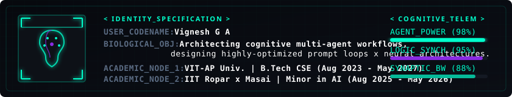
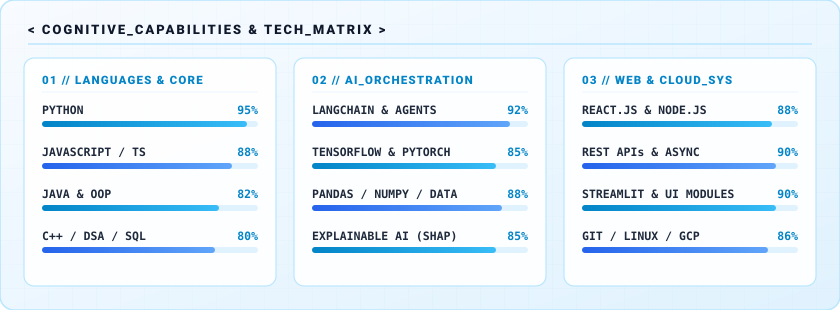
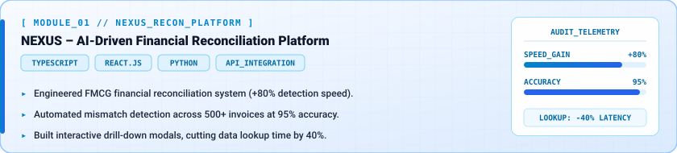
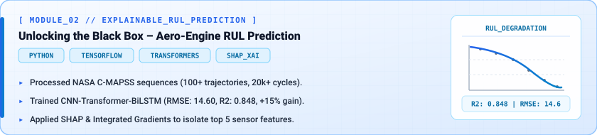
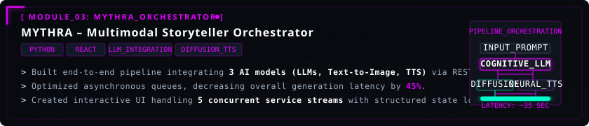
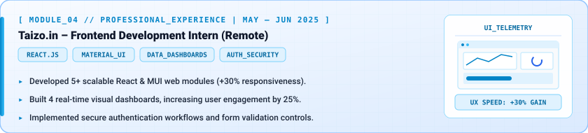

# Vignesh G A — AI & Prompt Engineer | Agentic AI Architect

  <!-- Widescreen Futuristic Light Blue HUD Header -->
  
  
    
  
  <!-- Biological Overview / Education HUD -->
  
  
    
  
  <!-- Interactive Skills Matrix -->
  

 

### <samp>&#10148; EXECUTABLE_MODULES: FEATURED_PROJECTS</samp>

  <!-- Project 1: NEXUS -->
  
  
    
  
  <!-- Project 2: Explainable RUL -->
  
  
    
  
  <!-- Project 3: MYTHRA -->
  
  
    
  
  <!-- Experience: Taizo.in -->
  

 

### <samp>&#10148; SECONDARY_COMPUTE_MODULES</samp>

| Model / System | System Description | Core Stack |
| :--- | :--- | :--- |
| **[ExpRAI (Face Emotion Recognition)](#)** | DenseNet-based facial emotion detection resolving nuanced expressions with 98.88% accuracy on CK+. | `Keras` `OpenCV` `Python` |
| **[DataSculpt Analytics App](#)** | Interactive dashboard analyzing user telemetry data to extract deep behavioral metrics and visualize platform engagement. | `Streamlit` `Pandas` |
| **[Google Cloud Computing Foundations](#)** | Certified in cloud architecture, distributed infrastructure, and scalable deployment workflows (Oct 2024). | `NPTEL` `Google Cloud` |

 

### <samp>&#10148; TELEMETRY: GITHUB_METRICS</samp>

  
  

 

  

 

### <samp>&#10148; CONSOLE_COMMUNICATION_LINK</samp>

  
  
  

 

<!-- Subtle Holographic Footer -->

  

